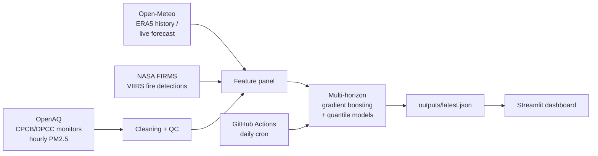

# 🌫️ SmogCast — 72-hour PM2.5 forecasts for Delhi NCR, with crop-fire attribution

Every October–November, PM2.5 across Delhi NCR climbs to "Very Poor" and "Severe" levels.
People, schools and clinics usually learn how bad a day is only once it has started.
SmogCast forecasts PM2.5 at each NCR monitoring station for the next 72 hours, turns it into
the India National AQI category with a plain-language health advisory, and estimates how much
of each forecast comes from crop-residue fires burning upwind in Punjab and Haryana.

**Live dashboard:** _add your Streamlit link here after deploying_

## How it works



| Stage | What happens |
|---|---|
| **Data** | Hourly PM2.5 from reference monitors (via OpenAQ), hourly weather (wind, boundary-layer height, humidity, rain), and satellite fire detections with fire radiative power (FRP). |
| **Quality control** | Removes monitor saturation (999), zeros, stuck flatlines (≥6 identical hours) and isolated spikes; fills gaps of ≤3 h only. |
| **Upwind fire score** | For each station, every fire is placed in one of 16 compass sectors and two distance bands. Each sector's FRP over the last 48 h is weighted by how well that sector lines up with the wind direction (cos² alignment). Smoke only matters when the wind brings it. |
| **Model** | One `HistGradientBoostingRegressor` covers all horizons 1–72 h, with the horizon as an input; it is trained on log PM2.5. Two quantile models give an 80% prediction interval. |
| **Evaluation** | Trained on data up to Sept 2025 (with a 3-day gap) and tested on the held-out Oct 2025 onward season. Compared against persistence, 24-h-mean persistence and station×month×hour climatology, on hourly error and on the 24-h average that the AQI is based on. |
| **Attribution** | Counterfactual: the same forecast with all fire features set to zero. The difference is the model's estimate of the smoke contribution. |
| **Deployment** | A GitHub Action runs every morning, pulls fresh data, writes `outputs/latest.json` and commits it. The Streamlit app only reads files, so it's fast and free to host. Every live forecast is logged and scored once observations arrive (`outputs/live_skill.json`), giving a real-world track record. |

## Results

_Filled in from `outputs/metrics.json` after training on real data._

| Next-day 24-h mean PM2.5 (held-out season) | MAE (µg/m³) | AQI category accuracy |
|---|---|---|
| SmogCast | – | – |
| Persistence (value now) | – | – |
| Persistence (last 24 h mean) | – | – |
| Climatology | – | – |

## Run it yourself

```bash
git clone https://github.com/Jayagna/smogcast.git
cd smogcast
python -m venv .venv && .venv\Scripts\activate          # Windows  (macOS/Linux: source .venv/bin/activate)
pip install -r requirements.txt

python -m smogcast demo        # synthetic data, no keys: checks that everything runs
```

For real data, get two free keys and put them in `.env` (copy `.env.example`):

- **OpenAQ**: <https://explore.openaq.org/register>
- **NASA FIRMS MAP_KEY**: <https://firms.modaps.eosdis.nasa.gov/api/map_key/>

```bash
python -m smogcast fetch       # ~3 years of history; resumable (about 15–30 min)
python -m smogcast train       # evaluate on held-out season, then refit on all data
python -m smogcast forecast    # next 72 h -> outputs/latest.json
streamlit run app/streamlit_app.py
```

## Deploy (free)

1. Push this repo to GitHub, including `models/smogcast.joblib` and `outputs/` from a real training run.
2. **Secrets**: repo → Settings → Secrets and variables → Actions → add `OPENAQ_API_KEY` and `FIRMS_MAP_KEY`.
3. **Daily forecasts**: Actions tab → enable workflows → run "Daily forecast" once by hand to check it works.
4. **Dashboard**: <https://share.streamlit.io> → New app → pick the repo, main file `app/streamlit_app.py`.

## Project layout

```
smogcast/
  data/        API clients: openaq.py, weather.py, firms.py
  clean.py     monitor quality control
  features.py  feature panel, upwind fire score, multi-horizon rows
  train.py     training, baselines, evaluation, attribution, importance
  forecast.py  live forecast, logging and live verification
  aqi.py       India National AQI breakpoints + advisories
  synthetic.py fake data for tests/demo only
app/streamlit_app.py   dashboard
.github/workflows/     daily forecast + tests
tests/                 unit tests (incl. a no-future-leakage test)
```

## Limitations

- Training uses ERA5 reanalysis weather, but live runs use forecast weather, so live error will be higher than the test-season numbers. The live track record measures this directly.
- Fire attribution is a model-based association, not chemical source apportionment.
- Satellites miss fires under cloud or thick smoke, and VIIRS passes only about twice a day.
- Station coverage depends on what OpenAQ receives from CPCB/DPCC.

## Roadmap

- Telegram/WhatsApp alerts when tomorrow is forecast to be "Very Poor" or worse
- Graph neural network across stations
- Benchmark against CAMS / SAFAR operational forecasts
- More cities in the Indo-Gangetic plain

## Data credits

OpenAQ (CPCB, DPCC, HSPCB data) · Open-Meteo (ERA5 by Copernicus/ECMWF) · NASA FIRMS (VIIRS 375 m active fires).
